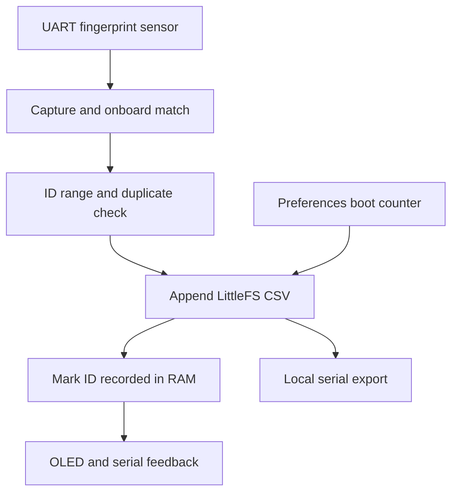

# Architecture and storage semantics

The sensor stores enrolled templates internally. The firmware requests capture, template conversion and match; it receives a sensor ID and confidence value. No raw image/template is read out by the attendance sketch. UART/library calls may block waiting for replies; this is a synchronous prototype, not a real-time or nonblocking design.

A fresh in-memory ID bitmap is created each boot. IDs 1–127 can be marked once per boot session. `Preferences` increments a persistent session number after filesystem validation. Reboots intentionally create a new session; a reset is not a trusted class/day boundary. No attendance roster or real-person identity mapping is implemented.

The log header is `boot_session,uptime_ms,sensor_id,confidence`. A row is appended only for an accepted match. Full reported byte count is required before the bitmap is updated or RECORDED is shown. Append failures disable further attendance until reboot/maintenance. There is no atomic transaction, read-back verification, journal repair or power-fail acknowledgement; interrupted/partial rows can remain. Export and inspect before relying on records.

The log is capped at 128 KiB. Automatic rotation/deletion is not implemented. A mount failure does not auto-format; initialization is an explicit serial maintenance command. Header validation rejects an incompatible existing log. Templates and Preferences are separate from LittleFS. Uptime is 32-bit milliseconds and wraps; it does not provide calendar time or a trustworthy time source.

OLED messages use short headings and smaller detail text within 128×64. Display failure permits serial-only operation. No network is initialized, and no cloud credentials are needed. Physical serial access can export local records; access control and at-rest encryption are not implemented.
