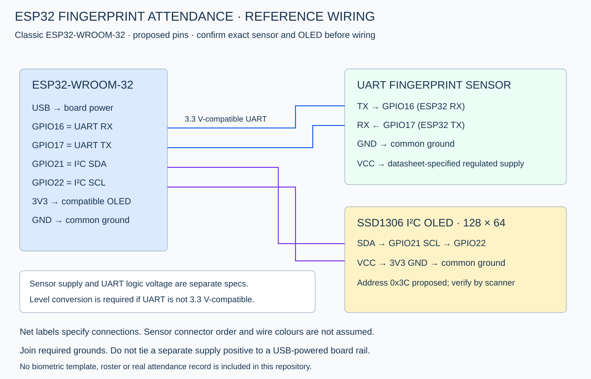

# Proposed reference wiring

Target: classic ESP32-WROOM-32 development board. Not a confirmed ESP32-S3 circuit. GPIO16/17 may be reserved on other modules; verify your board pinout.

| Device signal | ESP32 connection | Requirement |
|---|---|---|
| Fingerprint TX (sensor output) | GPIO16, ESP32 RX2 | Must be 3.3 V-compatible; level shift if required |
| Fingerprint RX (sensor input) | GPIO17, ESP32 TX2 | Verify module accepts 3.3 V high level |
| Fingerprint GND | ESP32 GND | Shared with any separate supply |
| Fingerprint VCC | Datasheet-specified regulated supply | Exact sensor model is unconfirmed |
| OLED SDA | GPIO21 | 3.3 V I²C logic |
| OLED SCL | GPIO22 | 3.3 V I²C logic |
| OLED VCC | 3V3 | Only a module specified to operate at 3.3 V |
| OLED GND | GND | Common ground |

UART wiring crosses TX to RX. Do not connect a 5 V UART output directly to an ESP32 GPIO. The sensor's supply voltage and UART voltage are different specifications. Check connector labels/datasheet rather than assuming wire colours. No specific sensor model has been verified compatible with this build.

USB powers the ESP32. Power the sensor using its specified voltage and a regulator/supply with sufficient peak current. Do not assume the board's 3V3 pin can power the sensor, and do not join a separate supply positive to a USB-powered board rail. Join only the required grounds. Disconnect power when wiring.

Use an SSD1306 128×64 I²C module with 3.3 V pull-ups. A SH1106 display or SPI display requires different code. Address 0x3C is an example to verify with an I²C scanner; 0x3D may be used by other modules. Confirm orientation and voltage on the actual board.
